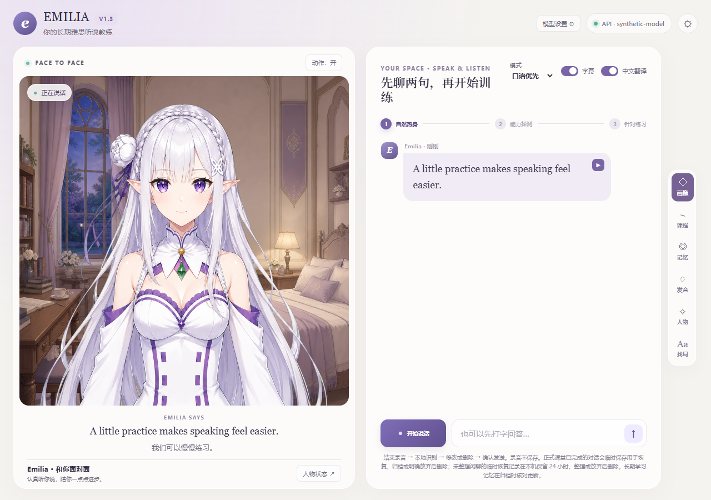

# EMILIA

[](https://github.com/birdCN/EMILIA/actions/workflows/ci.yml)

本地运行的英语口语练习应用，集成语音对话、结构化课程、表达反馈和学习记忆。

**代码 MIT License · Windows 10/11 x64 · 在线安装预览版**

当前版本为公开预览，适合试用与反馈。完整的干净 Windows 虚拟机、多硬件和不同网络环境验收尚未完成。

安装程序自动下载运行环境和语音模型。应用恢复原有爱蜜莉亚人物、表情与口型表演脚本，以及卧室背景。

[下载 Windows 安装包](https://github.com/birdCN/EMILIA/releases/download/v1.3.4/EMILIA-1.3.4-Setup-x64.exe) · [版本说明](https://github.com/birdCN/EMILIA/releases/tag/v1.3.4)



## 能做什么

- 语音和文字输入，支持编辑识别结果。
- 英语语音回复、中文翻译和表达反馈。
- 日常交流与结构化课程。
- 学习记录、能力证据与间隔复习。
- 可配置的人物设定和跨会话记忆。
- 记忆查看、纠正和删除。
- 会话恢复、课程归档和标签页隔离。
- 多服务商模型配置及 API 用量统计。

模型接口支持 OpenAI 兼容 Chat Completions SSE 和 Anthropic Messages SSE。

## 特点

语音对话、课程训练和学习记录集中在同一界面。识别、默认语音合成和数据存储在本机完成；语音与翻译、学习反馈分开处理。

响应时间取决于模型服务、网络、硬件和预热状态。学习反馈用于练习参考，不属于官方雅思评分。

## 快速开始

1. 在项目 Releases 下载 `EMILIA-1.3.4-Setup-x64.exe`，双击安装。
2. 安装程序自动下载约 2.4 GB 文件并检查模型，建议预留 8 GB 空间。首次安装需要网络；缺少 Microsoft 运行库时，按 Windows 提示允许安装。
3. 安装完成后打开桌面上的 **EMILIA**。首次使用按页面引导选择服务商，填写自己的 API Key 和模型 ID。
4. 保存后进入练习。下次直接打开桌面入口；关闭最后一个 EMILIA 页面后约 5 秒会自动退出后台；也可使用托盘菜单退出。

无需预装 Node.js、Python 或 CUDA。默认使用 CPU，建议至少 8 GB 内存，16 GB 及以上更合适。大型语音识别模型在较慢的 CPU 上需要更多等待。此安装版仅支持 Windows 10/11 x64；不支持 Windows ARM 或 macOS。

首次配置只保存设置，不会自动调用收费模型。日常练习需要能访问所选模型服务商。API 按服务商规则计费；安装包不附账号、余额或密钥。

关闭一个标签页不会结束其他正在使用的 EMILIA 页面；刷新或进入设置页不会误关。后台标签页保持可用。使用者填写的 API 与学习记录仍保存在其本机，发布包不附个人数据。

安装包尚未进行代码签名，Windows 可能显示未知发布者。请核对发布页提供的 SHA-256。

## 从源码运行

开发环境需要 Node.js 24 和 64 位 Python 3.13。在仓库根目录打开 PowerShell：

```powershell
py -3.13 -m venv .venv
.\.venv\Scripts\python.exe -m pip install -r requirements.txt
Copy-Item .env.example .env
# 阅读 THIRD_PARTY_NOTICES.md 后，再明确下载第三方模型：
.\.venv\Scripts\python.exe tools\setup_models.py --download
npm run doctor
npm start
```

打开 **http://127.0.0.1:4317/**，按首次使用引导填写接口信息。后续在右上角「模型设置」修改。若希望使用已登录的 Codex 通道，可在设置中明确切换；它依赖用户自己的本机安装与账号。

默认本地语音采用 CPU 配置，便于起步；大模型识别在 CPU 上可能明显较慢。GPU 是进阶配置，需要自行安装匹配的 CUDA、cuDNN 和推理运行时，参见 [安装说明](docs/SETUP.md)。

`setup_models.py --download` 从上游下载模型，文件保存在 `runtime/`，需要网络连接和数 GB 存储空间。

## 使用顺序

1. 配置模型接口。读取列表不等于所有模型都可聊天，可手填模型 ID。
2. 输入英文，或录音后检查识别结果再发送；首次本地模型预热可能较慢。
3. 闲聊用于自然交流；需要系统训练时再开始测评或课程。
4. 结束闲聊时到「记忆」选择「结束聊天并整理」，更新长期记忆。未整理记录按临时保留规则处理。
5. 选择「开始上课」进入课程，按照课堂提示完成训练。
6. 「中文翻译」关闭后不再为新回复生成翻译，已生成译文只隐藏。其他检查仍可能调用模型。

**API 按模型服务商规则计费。** 开场、回复、翻译、表达检查、备课、测评和记忆整理可能产生独立调用。并发请求和重试可能增加用量；最终费用以服务商账单为准。

## 隐私与数据

安装版将学习档案和加密接口设置存放于 `%LOCALAPPDATA%\EmiliaEnglishCoach\UserData`。应用和模型默认位于 `%LOCALAPPDATA%\Programs\EmiliaEnglishCoach`；下载缓存位于 `%LOCALAPPDATA%\EmiliaEnglishCoach\DownloadCache`。卸载保留学习档案和设置，缓存可单独删除。

源码启动默认将数据存放于 `runtime/`。`runtime/`、`user-data/` 与 `.env` 已列入 Git 忽略规则，请勿提交这些目录及文件。安装目录含日志、音频缓存与运行数据，不宜直接作为源码发布。

识别和默认 Kokoro 合成在本机；使用云端文本模型时，必要对话和所选记忆会发送给该服务商。长期记忆和临时恢复记录是两套机制。临时闲聊记录逻辑有效期为 24 小时，后台定期清理；整理或放弃后删除。此应用面向单用户本机，未提供多人公网部署所需的身份认证、隔离与配额。

## 本地测试

```powershell
npm test
```

测试使用合成数据和本地模拟接口，无需 API 密钥。模型及语音环境检查使用 `npm run doctor`，测试配置见 [测试说明](docs/TESTING.md)。

## 仓库结构

```text
.github/                  CI、Issue 与 PR 模板
public/                   网页、人物表演脚本与配套图片/背景
tests/                    合成数据、本地离线测试
tools/                    启动、检查、模型下载与 Python 语音服务
installer/                Windows 安装器、启动器及带哈希的下载清单
docs/                     安装、架构、测试、发布与隐私说明
server.mjs                本机服务及任务编排
*-memory*.mjs             记忆、检索与有效期维护
teacher-persona.mjs       主人格及模式规则
conversation-director.mjs 对话方向控制
package.json              Node 入口（无第三方 npm 运行依赖）
requirements.txt          Python 依赖
.env.example              无密钥示例配置
LICENSE                   MIT 源码许可
使用说明.txt              面向使用者的中文说明书
```

## 许可证

项目自行编写的源码按 [MIT](LICENSE) 发布，须保留版权与许可声明。人物图片、背景、依赖库、模型权重和声学资源的分发条件与源码许可分别处理，见 [第三方说明](THIRD_PARTY_NOTICES.md)。源码 MIT 许可不授予第三方角色形象或商标的权利。

欢迎贡献，参见 [CONTRIBUTING.md](CONTRIBUTING.md)。安全与隐私问题见 [SECURITY.md](SECURITY.md)。

构建安装程序与沙盒复测见 [Windows 安装版](docs/WINDOWS_INSTALLER.md)。
